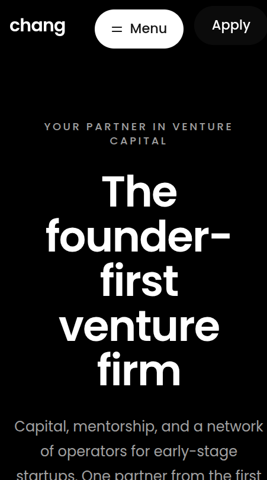
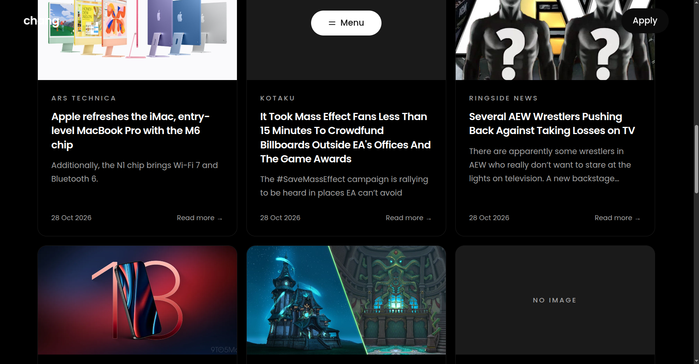

karena project saya tentang venture capital atau pendanaan startup jadi saya memanggil API berita tentang teknologi dari GNEWS dan output beritanya ada didalam halaman /news,

link api : https://gnews.io/dashboard

state loading yang ada di halaman /news: 
`      <section className="mx-auto max-w-6xl px-5 pb-20 sm:px-8 sm:pb-28">
        {loading && (
          

            Loading news…
            <FeaturedSkeleton />
            

              {[0, 1, 2].map((i) => (
                <SkeletonCard key={i} />
              ))}
            

          

        )}`

dan ini : `
        {!loading && error && (
          

            <h2 className="text-2xl font-semibold tracking-tight">
              Couldn&apos;t load the news
            </h2>
            
{error}

            <button
              type="button"
              onClick={() => setReloadKey((k) => k + 1)}
              className={`${btnPrimary} mt-6`}
            >
              Try again
            </button>
          

        )}`

## Home

## Navbar
